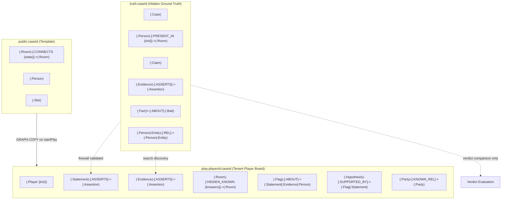

# Alibi — Every Lie Leaves a Path

> **Track 01: Agents That Act on Connected Data**  
> *Graph Hacks 2026 (WeMakeDevs & FalkorDB)*  
> Built by **Ayo** (Solo Project)

---

## 1. Pitch & Overview

**Alibi** is an investigative detective game where every statement, every piece of evidence, and every alibi becomes nodes and edges in a **FalkorDB** graph.

The player interrogates AI suspects, searches crime scenes for physical evidence, and watches their deduction board build in real time. But suspects lie. To crack each case, the player collaborates with an autonomous **AI Inspector** that reasons over the graph using graph queries and path-finding algorithms. When an alibi collapses or a suspect makes an impossible journey across locked rooms, the graph catches the lie—and the Inspector explains the exact path that proved it.

| Case Board & Conflict Threads | Timeline Grid & Rehearsed Story |
|:---:|:---:|
|  |  |
| *Graph board with contradiction threads* | *Timeline grid showing rehearsed alibi brackets* |

| Live Inspector Reasoning Stream | Verdict Replay & Ground Truth |
|:---:|:---:|
|  |  |
| *Autonomous AI Inspector running graph tools* | *Accusation score, replay path, and what was missed* |

---

## 2. Why This Needs a Graph

A relational database or vector store cannot efficiently solve the deduction mechanics of Alibi. Every core feature relies on connected graph topologies, traversal algorithms, and tenant graph isolation:

1. **The Information Barrier (Graph-Level Multi-Tenancy)**  
   Ground truth (`truth:{caseId}`) is kept completely segregated from the player's deduction graph (`play:{playerId}:{caseId}`). Neither the player, the LLM, the AI Inspector, nor external MCP agents ever see the truth graph. Tenants are discrete graphs, not `WHERE` clauses.
2. **Contradictions as Graph Pattern Matching**  
   A lie is detected when two assertion nodes disagree on a suspect's location for the same time slot:
   ```cypher
   MATCH (a:Assertion), (b:Assertion)
   WHERE a.subject = b.subject AND a.slot = b.slot AND a.room <> b.room AND a.src < b.src
   RETURN a.src AS srcA, a.room AS roomA, b.src AS srcB, b.room AS roomB
   ```
3. **Feasibility via Shortest Path Traversal**  
   Moving between rooms takes 1 time slot per edge. Given hard anchors (camera stills, door logs), can a suspect physically traverse the map between slot $i$ in room $A$ and slot $j$ in room $B$? FalkorDB calculates the shortest path over active edges:
   $$\text{feasible} \iff \text{shortestPath}(A, B) \le |j - i|$$
   If door locks or hidden passage access rules (`knowers`) block the path, the suspect is provably cleared or exposed.
4. **Elimination Chains**  
   Physical evidence records an act (e.g. breaker cut at slot 4). Graph feasibility eliminates impossible suspects one by one. When only a single candidate remains, an inferred anchor node `(:Assertion {hard: true, src: 'inferred:<id>'})` is written to the graph, immediately triggering downstream contradictions against their prior claims.
5. **Alibi-Support Chains**  
   Witness sightings form a dependency tree: suspect $A$ claims to be in the lounge because witness $B$ claims to have seen them there. If graph contradictions place witness $B$ elsewhere, the entire alibi chain breaks.
6. **Multi-Hop Motive Traversals**  
   Variable-length path queries `(p:Party)-[:KNOWN_REL*1..3]-(v:Person {victim: true})` uncover hidden corporate, familial, and financial ties to the victim across intermediate entities.

---

## 3. Quickstart

Get Alibi up and running locally in 5 commands:

```bash
# 1. Start FalkorDB and FalkorDB Browser
docker compose up -d falkordb

# 2. Install dependencies & configure git hooks
pnpm i

# 3. Validate case graphs and mathematical solvability (offline check)
pnpm cases:validate

# 4. Run the full test suite (75 tests against live FalkorDB)
pnpm test

# 5. Start the web application on port 3001
pnpm dev
```

Open [http://localhost:3001](http://localhost:3001) in your browser.

- **FalkorDB Browser:** Available at [http://localhost:3000](http://localhost:3000) to inspect graph queries and node structures live.
- **Offline / Free-Tier Mode (`ALIBI_LLM=off`):** The game runs 100% deterministically without an API key by falling back to pre-authored claim texts. To enable live Gemini synthesis, set `GEMINI_API_KEY` in `.env`.
- **Reset Demo State:** Run `pnpm demo:reset` to clear all player demo graphs.
- **Model Context Protocol (MCP):** Run `pnpm mcp` to start the stdio MCP server.

---

## 4. The Three Levels & Season 1 Arc

Season 1 introduces three original, self-contained mystery cases designed to teach distinct graph reasoning capabilities:

| Level | Case | Premise | Graph Mechanics Taught |
|:---|:---|:---|:---|
| **Level 1** | *The Quiet Pact* | A theatre director is murdered in the prop store during rehearsal. Three actors tell identical stories. | Contradiction pattern matching, rehearsed alibi grouping, clearing an innocent suspect by impossibility. |
| **Level 2** | *The Stopped Watch* | An antiquarian is found dead next to a smashed pocket watch stopped at 9:40 PM. | Time-of-death window revision, impossible movement sequences, baiting a suspect into a knowledge slip. |
| **Level 3** | *The Blackout Dinner* | An estate patriarch is killed in a locked study during an 8-minute power cut. | Hidden passage discovery (`HIDDEN_KNOWN`), candidate elimination, alibi-support chain collapse, multi-hop motive paths. |

### Season 1 Arc: "The Auditor"
Every case solved unearths an archival dossier fragment pointing toward a shadow syndicate known as *The Auditor*. The clues combine on the player's dossier to reveal the conspiracy setting up Season 2.

---

## 5. Graph Data Model

Alibi maintains three distinct graph scopes to preserve the **Information Barrier**:



### Graph Topologies
1. `truth:{caseId}`: Master ground truth created once during seeding. Contains true movements (`PRESENT_IN`), all claims with truth labels, crime scene parameters, and fact knowledge maps.
2. `public:{caseId}`: Clean case template with public rooms, standard doors, suspect biographies, and time slots.
3. `play:{playerId}:{caseId}`: The isolated tenant workspace. When a player begins a case, `GRAPH.COPY` clones `public:{caseId}` into `play:{playerId}:{caseId}`. As statements are taken and rooms are searched, nodes are added exclusively to this graph.
4. `player:{playerId}`: Anonymous persistence graph tracking case completions, brass stars, and accusation counts.

---

## 6. Queries and Algorithms

All Cypher queries are parameterised, named constants stored in [`src/engine/queries/`](file:///home/saturnsurfer/Documents/PROJECTS/alibi/src/engine/queries/) and mirrored in [`queries/`](file:///home/saturnsurfer/Documents/PROJECTS/alibi/queries/). The LLM **never** writes or executes arbitrary Cypher.

| Query ID | Name | Target Graph | Purpose |
|:---|:---|:---|:---|
| `Q00` | `graph_list` | System | Check existing database graphs |
| `Q01` | `graph_copy` | System | Clone public case template to player graph (`GRAPH.COPY`) |
| `Q02` | `graph_delete` | System | Reset player graph (`GRAPH.DELETE`) |
| `Q10-Q19` | `seed_*` | Truth/Public | Idempotent database seeding for rooms, edges, claims, facts, and cases |
| `Q20-Q24` | `lifecycle_*` | Play/Player | Player creation, tick counters, and career progress upsert |
| `Q40` | `select_claims` | Truth | Select eligible suspect claims filtered by knowledge firewall |
| `Q41-Q45` | `board_writes` | Play | Write statements, assertions, and revealed relations to the board |
| `Q50` | `evidence_in_room` | Truth | Retrieve evidence located in a searched room |
| `Q51-Q59` | `evidence_writes` | Play | Add evidence, search logs, revealed passages, and inferred anchors |
| `Q60` | `contradictions` | Play | **Contradiction match:** Find assertion pairs placing person in 2 places at slot |
| `Q61` | `rehearsed` | Play | **Rehearsed alibis:** Group statements with identical room and detail |
| `Q62` | `assertion_pairs` | Play | **Movement order:** Assertion sequences for impossible travel detection |
| `Q63` | `distance` | Play | **Shortest path:** Compute path distance respecting doors and knowers |
| `Q64` | `map_edges` | Play | Retrieve active connectivity topology |
| `Q66` | `hard_anchors` | Play | Fetch all hard assertions for a suspect |
| `Q67` | `room_degree` | Play | Check reachable room connectivity |
| `Q68` | `evidence_act` | Play | Query act slot, room, and candidate constraints |
| `Q70` | `motive_paths` | Play | **Multi-hop traversal:** 1-3 hop paths from suspect to victim |
| `Q71` | `alibi_support` | Play | **Alibi chain:** Check witness reliability and contradiction status |
| `Q72` | `window` | Play | Calculate active time-of-death window |
| `Q80-Q83` | `notes_writes` | Play | Write Flags and Hypotheses nodes onto the board |
| `Q90-Q92` | `bait_*` | Truth/Play | Evaluate suspect slip reactions based on knowledge asymmetry |
| `Q95-Q99` | `verdict_*` | Truth/Play | Evaluate final accusation against solution and calculate score |

---

## 7. Tool Catalogue & MCP Server

The reasoning engine exposes 8 read tools and 2 board write tools governed by strict [Zod schemas](file:///home/saturnsurfer/Documents/PROJECTS/alibi/src/engine/contract.ts):

| Tool | Type | Description |
|:---|:---|:---|
| `getBoard` | Read | Returns complete player graph: statements, evidence, flags, hypotheses, threads. |
| `findContradictions` | Read | Finds conflicting assertions for same person & slot across the play graph. |
| `findRehearsedAlibis` | Read | Identifies suspicious story duplication across 2 or more suspects. |
| `findImpossibleMoves` | Read | Identifies journeys that exceed reachable physical distance between slots. |
| `checkFeasibility` | Read | Determines if a person could have reached a room at a slot given hard anchors. |
| `whoCouldHave` | Read | Evaluates candidates for an act piece of evidence, returning survivors. |
| `motivePaths` | Read | Traverses multi-hop relationship chains between suspect and victim. |
| `alibiSupport` | Read | Evaluates whether a witness alibi is corroborated or collapsed. |
| `flag` | Write | Drops a visual Flag note onto specific board nodes with an explanation. |
| `hypothesize` | Write | Writes a deduction Hypothesis node connected to supporting flags. |

### Model Context Protocol (MCP) Integration
Any external MCP-compliant agent (Claude Desktop, Cursor, AGY) can connect directly to Alibi's reasoning engine via stdio:

```json
{
  "mcpServers": {
    "alibi": {
      "command": "pnpm",
      "args": ["mcp"],
      "cwd": "/path/to/alibi"
    }
  }
}
```

The MCP server exposes all 8 reasoning read tools, enabling external agents to analyze player boards and solve cases using graph reasoning.

---

## 8. Oracle Parity and Case Validation

To ensure fair mysteries without plot holes or mathematical ambiguity, Alibi implements dual verification:

1. **The Reference Engine (`scripts/reference-engine.mjs`):**  
   A pure JavaScript oracle implementation of every reasoning tool. Vitest tests (`tests/engine/reasoning.test.ts`) assert exact 1:1 parity between Cypher execution in FalkorDB and the oracle across cold, partial, and completed boards.
2. **Case Solvability Validation (`scripts/validate-cases.mjs`):**  
   Every case JSON file is validated mathematically before runtime:
   - Exactly the intended culprits are solvable.
   - Every false claim is detectable through contradictions, impossible moves, or inferred anchors.
   - Every innocent suspect is provably cleared.
   - Baits with 1 knower point only to guilty culprits.

```bash
$ pnpm cases:validate
PASS  l1-quiet-pact      — 20 claims, 5 evidence, 4 suspects, 9 contradictions
PASS  l2-stopped-watch   — 17 claims, 9 evidence, 4 suspects, 5 contradictions, 4 impossible moves
PASS  l3-blackout-dinner — 26 claims, 11 evidence, 6 suspects, 11 contradictions
All cases valid.
```

---

## 9. Track 01 Coverage Table

| Track 01 Requirement | How Alibi Satisfies It |
|:---|:---|
| **Multi-hop reasoning** | 1-3 hop motive traversals (`Q70`), shortest path journey validation (`Q63`), multi-step candidate elimination chains, and alibi dependency trees (`Q71`). |
| **Graph queries as agent tools** | 10 formal tools backed by 58 named, parameterised Cypher queries executed via FalkorDB's official client. |
| **Tool selection through MCP** | Standalone stdio MCP server (`pnpm mcp`) exposing the full reasoning tool suite to outside agents. |
| **Actions based on graph output** | Autonomous AI Inspector writes `Flag` and `Hypothesis` nodes onto the user's board and renders dynamic conflict threads based on query results. |
| **Explainable results** | Every tool call returns a complete `TraceStep[]` (query ID, parameters, rows, latency ms) and step-by-step room traversal paths. |

---

## 10. Demo Video & Local Setup

- **Demo Video:** *[Insert 3-Minute Demo Video Link]*
- **Local Dev Server:** Runs on port `3001` (`pnpm dev`) to avoid conflicting with FalkorDB Browser on `3000`.
- **Keyboard Shortcuts:** Press `?` in-game to view hotkeys (`1-4` panel tabs, `Space` ask suspect, `S` search room, `B` use bait, `A` accuse, `P` present mode).

---

## 11. AI Usage Disclosure

Per hackathon guidelines, AI coding assistance is fully disclosed:
- **Assistant:** Gemini 3.8 Flash via Google DeepMind Antigravity CLI.
- **Human Author & Architect (Ayo):** Conceived the original product architecture, designed the tripartite information barrier model, authored all three original mystery plots and clues, specified the design system (`DESIGN.md`), and authored the Cypher query catalog.
- **AI Coding Agent:** Assisted with implementing TypeScript schemas, unit tests, parity test suites against the oracle, React components, and styling token enforcement.
- **Commit History:** Every agent-assisted commit includes the mandatory `Assisted-by: Gemini 3.8 Flash` trailer.

---

## 12. Originality and Credits

Inspired by classic closed-circle detective fiction and consultant-detective television. All cases, characters, floor plans, and puzzles are original fictional works. No third-party scripts, plots, or intellectual property were used.

Released under the **MIT License**.
