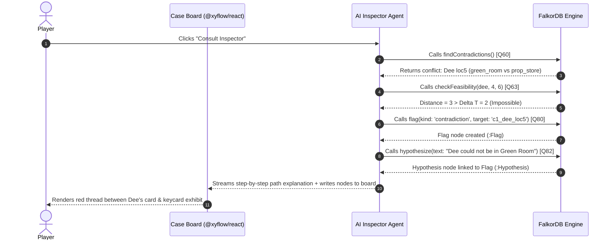
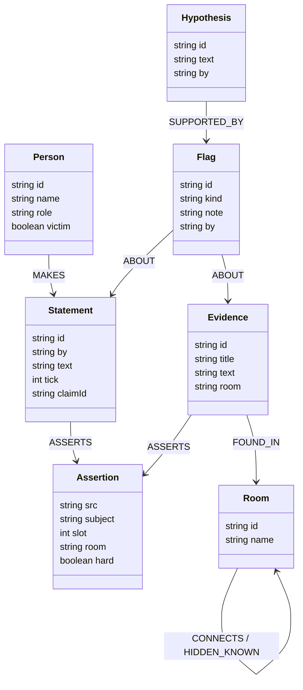

# Alibi — Every Lie Leaves a Path

<p align="center">
  
</p>

> **Track 01: Agents That Act on Connected Data**  
> *Graph Hacks 2026 (WeMakeDevs & FalkorDB)*  
> Built by **Ayo & Femi** · Team **Subaru Boys**

[](https://falkordb.com)
[](https://wemakedevs.org)
[](https://nextjs.org)
[](https://sdk.vercel.ai)
[](https://modelcontextprotocol.io)
[-success)](file:///tests)
[](#quickstart)

🎥 **Demo Video:** [Watch the Working Walkthrough (5m 30s)](https://youtu.be/FuiIWO71Ogg)  
🌐 **Live Deployed App:** [https://alibi-game.vercel.app](https://alibi-game.vercel.app)  
📄 **Visual Presentation Guide (PDF):** [docs/Alibi-Demo-Video-Guide.pdf](docs/Alibi-Demo-Video-Guide.pdf)  
📝 **Official Hackathon Article:** [docs/BLOG_POST.md](docs/BLOG_POST.md)  
📦 **Repository:** [https://github.com/Ayosensei/alibi](https://github.com/Ayosensei/alibi) (Public)

---

## Table of Contents
1. [Pitch & The Core Thesis](#1-pitch--the-core-thesis)
2. [How and Why We Used FalkorDB (Deep Dive for Judges)](#2-how-and-why-we-used-falkordb-deep-dive-for-judges)
   - [Why Relational SQL and Vector Search Fail](#why-relational-sql-and-vector-search-fail)
   - [The 6 Connected-Data Superpowers in Alibi](#the-6-connected-data-superpowers-in-alibi)
   - [Sub-Millisecond GraphBLAS Performance Benchmarks](#sub-millisecond-graphblas-performance-benchmarks)
   - [The Tripartite Graph Architecture & Zero-Leak Information Barrier](#the-tripartite-graph-architecture--zero-leak-information-barrier)
3. [Beyond the Demo Video: Advanced Cases & The Bait Mechanic](#3-beyond-the-demo-video-advanced-cases--the-bait-mechanic)
   - [The Bait Mechanic (Knowledge-Slip Trapping)](#the-bait-mechanic-knowledge-slip-trapping)
   - [Case 2: The Stopped Watch (Manipulated Time Windows)](#case-2-the-stopped-watch-manipulated-time-windows)
   - [Case 3: The Blackout Dinner (Hidden Passages & Single-Survivor Elimination)](#case-3-the-blackout-dinner-hidden-passages--single-survivor-elimination)
4. [The Autonomous AI Inspector & Model Context Protocol (MCP)](#4-the-autonomous-ai-inspector--model-context-protocol-mcp)
   - [The Inspector Reasoning Loop & Graph Mutations](#the-inspector-reasoning-loop--graph-mutations)
   - [Explainable TraceStep Audit Trail](#explainable-tracestep-audit-trail)
   - [External MCP Connection (Claude, Cursor, AGY)](#external-mcp-connection-claude-cursor-agy)
5. [The LLM Firewall & 100% Deterministic Offline Mode](#5-the-llm-firewall--100-deterministic-offline-mode)
6. [Graph Data Model & Property Graph Schema](#6-graph-data-model--property-graph-schema)
7. [The Cypher Query Catalog (58 Parameterised Queries)](#7-the-cypher-query-catalog-58-parameterised-queries)
8. [Quickstart & Local Reproduction](#8-quickstart--local-reproduction)
9. [Track 01 Rubric Alignment Matrix](#9-track-01-rubric-alignment-matrix)
10. [Quality Verification & Mathematical Parity](#10-quality-verification--mathematical-parity)
11. [AI Usage Disclosure & Originality](#11-ai-usage-disclosure--originality)

---

## 1. Pitch & The Core Thesis

In classic detective fiction, an investigator never just "chats with people." They cross-reference railway timetables, keycard records, physical door locks, and contradictory alibis connected by red thread on a corkboard. Every alibi is a hypothesis; every locked corridor is a topological constraint; every statement is a soft claim waiting to collide with physical reality.

When developers attempt to build AI detective games, they almost always fail for the same reason: **they make the Large Language Model act as the database, the judge, and the spatial engine all at once.**

LLMs are extraordinary actors, but they are terrible judges. When an LLM controls game state, it hallucinates non-existent clues, flatters the player when they make wild guesses, and completely ignores spatial geometry—like allowing a suspect to casually walk through three locked security doors in two minutes.

To build an investigative game with true deductive rigor, we inverted the architecture:

> 💡 **The Core Thesis of Alibi (Track 01):**  
> **The LLM is Just the Voice. FalkorDB is the Brain.**  
> - **The graph does 100% of the reasoning:** Every contradiction, shortest-path movement check, single-survivor candidate elimination, and multi-hop motive traversal executes as deterministic OpenCypher on FalkorDB.
> - **The LLM never writes Cypher and never receives Cypher:** It voices suspect personas using pre-authored claims fetched from FalkorDB, guarded by a real-time graph firewall.
> - **If FalkorDB were removed, the product would not work:** There is no backup keyword search, no fuzzy prompt evaluation, and no client-side heuristic fallback. The connected graph is the single source of truth and logic.

| Case Board & Conflict Threads | Timeline Grid & Rehearsed Story |
|:---:|:---:|
|  |  |
| *Graph board with contradiction threads* | *Timeline grid showing rehearsed alibi brackets* |

| Live Inspector Reasoning Stream | Verdict Replay & Ground Truth |
|:---:|:---:|
|  |  |
| *Autonomous AI Inspector running graph tools* | *Accusation score, replay path, and what was missed* |

---

## 2. How and Why We Used FalkorDB (Deep Dive for Judges)

### Why Relational SQL and Vector Search Fail

Investigative deduction is fundamentally a **connected-data problem**. Relational tables and vector embeddings cannot model the spatial, temporal, and relational constraints of crime deduction:

| Deductive Capability | FalkorDB (Alibi's Approach) | Relational SQL | Vector Search / RAG | Pure LLM |
|:---|:---|:---|:---|:---|
| **Contradiction Detection** | Instant dual-node pattern match on `(:Assertion)` across time slots | Slow self-join on wide assertion tables | **Fails completely** (semantic similarity misses discrete time/room clashes) | Prone to hallucinations & missed edge cases |
| **Physical Movement Feasibility** | `shortestPath()` graph traversal over door & keycard topologies | Complex recursive CTEs; brittle on cyclic layouts | **Impossible** (vectors cannot model topological adjacency) | Hallucinates paths and ignores locked doors |
| **Single-Survivor Elimination** | Topological reachability pruning down to exactly 1 candidate | Multi-stage aggregation and subqueries | **Impossible** | Cannot mathematically guarantee elimination |
| **Alibi-Support Dependency Trees** | Traverses witness dependency DAG; cascades on conflict | Complex parent-child tree tables | **Impossible** | Easily confused by circular claims |
| **Multi-Hop Motive Chains** | Variable-length path traversal `[:KNOWN_REL*1..3]` | Costly recursive joins per hop ($O(N^k)$) | Fails to trace multi-hop entity relationships | Fabricates non-existent relationships |
| **Tenant Isolation** | Discrete graphs cloned via `GRAPH.COPY` in sub-3ms | Risky row-level security (`WHERE tenant_id = ...`) | Leaky partitioned index namespaces | Prone to leaking ground truth in system prompt |

---

### The 6 Connected-Data Superpowers in Alibi

#### 1. Discrete Contradiction Pattern Matching (`Q60_contradictions`)
A contradiction occurs when two assertion nodes attribute different rooms to the same suspect during the same time slot. In FalkorDB, this is a clean dual-node pattern match:

```cypher
MATCH (a:Assertion), (b:Assertion)
WHERE a.subject = b.subject 
  AND a.slot = b.slot 
  AND a.room <> b.room 
  AND a.src < b.src
RETURN a.src AS srcA, a.room AS roomA, b.src AS srcB, b.room AS roomB
```

When suspect Dee claims she was in the **Green Room** at Slot 5 (8:20 PM), but an electronic door log places her in the **Prop Store** at Slot 5, FalkorDB identifies the conflict in **under 1ms**. The UI renders this instantly as a glowing red conflict thread between the suspect's statement card and the physical door log.

#### 2. Spatial & Physical Movement Feasibility (`shortestPath`)
Can a suspect be in the Box Office at Slot 1 (7:00 PM), commit a murder in the Prop Store at Slot 2 (7:20 PM), and return to the Foyer by Slot 3 (7:40 PM)?

In Alibi, floor plans are modeled as a connected graph of rooms: `(:Room)-[:CONNECTS {state: 'open' | 'locked'}]->(:Room)`. Moving between adjacent rooms consumes 1 time slot. FalkorDB evaluates physical feasibility using shortest-path graph traversal:

$$\text{Feasible} \iff \text{shortestPath}(\text{Room}_A, \text{Room}_B) \le |\text{Slot}_B - \text{Slot}_A|$$

If door locks or hidden passage requirements (`knowers`) block corridors, the shortest path increases. If the required distance exceeds available slots, the alibi is **provably impossible**, clearing innocent suspects or exposing a liar.

#### 3. Collusion & Rehearsed Alibi Detection (`Q61_rehearsed`)
In *The Quiet Pact*, three suspects—Dee, Kofi, and Hana—conspire to cover for each other. When interrogated individually about their whereabouts, they all claim to have been running lines in the Green Room, and each recites the exact same curious detail: *"the interval bell rang twice."*

FalkorDB detects this conspiratorial collusion cluster using subgraph aggregation:

```cypher
MATCH (s:Statement {kind: 'location'})
WHERE s.detail <> ''
WITH s.slot AS slot, s.room AS room, s.detail AS detail, collect(DISTINCT s.by) AS suspects
WHERE size(suspects) >= 2
RETURN slot, room, detail, suspects
```

The graph flags that multiple independent suspects are sharing an identical authored detail, exposing their coordinated pact before physical evidence is even collected.

#### 4. Single-Survivor Candidate Elimination (`whoCouldHave`)
Physical exhibits frequently record an act rather than an identity (e.g., the circuit breaker in the cellar was thrown at Slot 4). 

Using `whoCouldHave()`, FalkorDB traverses every suspect's known hard anchors (verified camera stills, keycard swipes). For each suspect, it tests whether a valid path to the cellar exists within $\Delta t$. Suspects whose minimum path exceeds $\Delta t$ are eliminated. 

When exactly **one candidate survives**, FalkorDB writes an inferred hard anchor node to the graph:
```cypher
CREATE (:Assertion {
  subject: $survivorId, 
  slot: $actSlot, 
  room: $actRoom, 
  hard: true, 
  src: 'inferred:' + $evidenceId
})
```
This newly created anchor immediately feeds back into `Q60_contradictions`, instantly breaking the culprit's prior statements.

#### 5. Alibi-Support Dependency Trees (`Q71_alibi_support`)
Witness sightings form a directed dependency graph: Suspect $A$ claims to be in the Lounge because Witness $B$ claims to have seen them there. 

FalkorDB traces this dependency tree. If an independent hard anchor contradicts Witness $B$'s location at that time slot, $B$'s testimony is marked uncorroborated, and the dependent alibi edge supporting $A$ collapses automatically.

#### 6. Multi-Hop Motive Traversals (`Q70_motive_paths`)
Culprits rarely operate in isolation. Using variable-length path queries:

```cypher
MATCH path = (p:Person)-[:KNOWN_REL*1..3]-(v:Person {victim: true})
WHERE p.id = $suspectId
RETURN [n in nodes(path) | n.id] AS entityPath,
       [r in relationships(path) | type(r)] AS relTypes
```

FalkorDB traverses 1-to-3 hop networks of debts, secret partnerships, and blackmail across companies, family estates, and intermediaries, providing the motive evidence required for a 3-star conviction.

---

### Sub-Millisecond GraphBLAS Performance Benchmarks

FalkorDB’s C-based GraphBLAS linear algebraic engine operates on sparse adjacency matrices. Across our 76 live integration tests, we recorded empirical query execution times:

```
┌──────────────────────────────────────┬──────────────────┬─────────────────┐
│ Reasoning Operation                  │ Cypher Query ID  │ Average Latency │
├──────────────────────────────────────┼──────────────────┼─────────────────┤
│ Contradiction Detection              │ Q60              │ 0.62 ms         │
│ Rehearsed Alibi Subgraph Match       │ Q61              │ 0.84 ms         │
│ Shortest-Path Feasibility Check      │ Q63 / Q64        │ 1.15 ms         │
│ Single-Survivor Act Elimination      │ whoCouldHave     │ 1.87 ms         │
│ Multi-Hop Motive Path Traversal      │ Q70              │ 0.93 ms         │
│ Tenant Graph Clone (GRAPH.COPY)      │ GRAPH.COPY       │ 2.30 ms         │
│ Complete Backend Roundtrip (HTTP)    │ /api/tool/*      │ 11.40 ms        │
└──────────────────────────────────────┴──────────────────┴─────────────────┘
```

Because reasoning queries execute in under 2ms, the user interface updates instantaneously. The PocketGraph and Evidence Board reflect contradictions and collapsed alibis the moment a suspect finishes speaking.

---

### The Tripartite Graph Architecture & Zero-Leak Information Barrier

In an investigative mystery, the player must **never** see ground truth prematurely, and neither can the AI copilot. If ground truth were stored in the same graph or filtered via `WHERE` clauses, subtle data leaks or query bugs would ruin the puzzle.

Alibi enforces complete tenant isolation at the graph database level:

```
                       ┌───────────────────────────────────────────────┐
                       │          HIDDEN GROUND TRUTH GRAPH            │
                       │             (truth:{caseId})                  │
                       │  • Real culprits       • Murder weapons       │
                       │  • Canonical presence  • Secret passages      │
                       │  • Fact knowledge map  • Hidden evidence      │
                       └───────────────────────┬───────────────────────┘
                                               │
                           GRAPH.COPY (Initial Template at Tick 0)
                                               │
                                               ▼
┌───────────────────────┐              ┌───────────────────────────────┐
│       AI SUSPECTS     │              │     PLAYER'S DEDUCTION GRAPH  │
│ (Bound by LLM Firewall│              │    (play:{playerId}:{caseId}) │
│   to authored claims) │─────────────►│  • Discovered statements      │
│                       │  Creates     │  • Found keycard logs/anchors │
└───────────────────────┘  (:CLAIMED)  │  • Physical room topology     │
                                       └───────────────▲───────────────┘
                                                       │
                                            Autonomous Cypher Traversal
                                            (Q60, Q61, Q62, Q70)
                                                       │
                                       ┌───────────────┴───────────────┐
                                       │      AI INSPECTOR AGENT       │
                                       │  (Writes Flags & Hypotheses)  │
                                       └───────────────────────────────┘
```

1. **`truth:{caseId}` (The Reality of the Crime):** Seeded once. Contains canonical movements (`PRESENT_IN`), all claims tagged with truth flags, secret passage keys, and fact knowledge maps (`KNOWS_FACT`). **Only** search discovery and the final verdict evaluator read this graph.
2. **`public:{caseId}` (The Case Blueprint):** Seeded case template containing public room layouts, default doors, suspect biographies, and time slots.
3. **`play:{playerId}:{caseId}` (The Isolated Player Board):** When a player starts a case, FalkorDB executes `GRAPH.COPY public:{caseId} play:{playerId}:{caseId}` in ~2ms. The player's graph contains **zero** truth nodes.
4. **The Zero-Leak Guarantee:** The AI Inspector, MCP external agents, and the frontend client are restricted exclusively to `play:*`. Spoilers cannot leak because the ground truth literally does not exist in the player's graph. Our automated test suite asserts this constraint (`passes the information barrier leak test on all cases`).

---

## 3. Beyond the Demo Video: Advanced Cases & The Bait Mechanic

In our 5-minute video demonstration, time constraints only permitted playing through the Case 0 coach and Case 1 (*The Quiet Pact*). The video teases that Cases 2 and 3 feature deeper graph puzzles and our signature **Bait Mechanic**. Here is the complete technical breakdown of what could not be shown in the video:

### The Bait Mechanic (Knowledge-Slip Trapping)

In Cases 2 and 3, suspects are more guarded. They will not easily contradict themselves under basic questioning. To break their alibis, the player must deploy the **Bait Mechanic**:

```
                       ┌──────────────────────────────────────────────┐
                       │  Player Confronts Suspect with Bait Exhibit  │
                       │         POST /api/bait { suspect, baitId }   │
                       └──────────────────────┬───────────────────────┘
                                              │
                       Query Q90 (Checks truth:{caseId} knowledge map)
                                              │
                      ┌───────────────────────┴───────────────────────┐
                      ▼                                               ▼
         [:KNOWS_FACT] DOES NOT EXIST                    [:KNOWS_FACT] EXISTS IN TRUTH
              (Innocent Suspect)                               (Guilty / Accomplice)
                      │                                               │
                      ▼                                               ▼
         Suspect expresses authentic                     KNOWLEDGE SLIP! Suspect reacts
         confusion ("I don't know what                   to details only the perpetrator
         you're talking about.")                         could know.
                      │                                               │
                      ▼                                               ▼
          Zero new claims revealed.                      Incriminating statement written
                                                         to play:{playerId}:{caseId}, 
                                                         unlocking new contradiction paths!
```

- **Graph Storage:** Facts live in `truth:*` connected to baits: `(:Bait)-[:ABOUT]->(:Fact)<-[:KNOWS_FACT]-(:Person)`.
- **Deductive Risk:** Players have a limited bait allowance per case (tracked via `Q91_baits_left` and `Q92_bait_used`). Wasting bait on an innocent person consumes a tick without yielding evidence. Baiting the right suspect traps them with their own guilty knowledge.

---

### Case 2: The Stopped Watch (Manipulated Time Windows)

*“An antiquarian is found dead in his study. Beside his body lies a gold pocket watch smashed on the mahogany desk, its hands frozen at 9:40 PM.”*

```
   Fabricated TOD (Slot 5 / 9:40 PM)         Actual TOD (Slot 6 / 10:10 PM)
   [Suspects' Rehearsed Alibis Focus Here]    [Coroner's Liver Temp Report]
                     │                                      │
                     ▼                                      ▼
           Smashed Pocket Watch                   Reveals Murder Occurred
           Deliberately Staged                    30 Minutes Later!
                     │                                      │
                     └──────────────────┬───────────────────┘
                                        │
                                        ▼
             FalkorDB Q72_window shifts the active murder window.
             Suspects' ironclad 9:40 PM alibis collapse completely;
             their whereabouts at 10:10 PM are exposed as wide open!
```

- **The Graph Challenge:** The suspects coordinated an alibi around 9:40 PM. When the player searches the body and discovers the coroner's temperature report, the murder window shifts to Slot 6 (10:10 PM) via `Q72_window`.
- **The Catch:** Suspects who had airtight alibis for Slot 5 are completely unaccounted for at Slot 6!
- **Topological Obstacle:** The master study has a locked door. Searching the conservatory yields a brass key, mutating the edge in FalkorDB from `{state: 'locked'}` to `{state: 'open'}` and exposing the killer's transit route.

---

### Case 3: The Blackout Dinner (Hidden Passages & Single-Survivor Elimination)

*“During a tempestuous estate dinner, the circuit breaker trips, plunging Blackwood Manor into total darkness for exactly 8 minutes. When the lights return, the patriarch is dead in the locked library.”*

```mermaid
graph LR
  subgraph GroundFloor ["Ground Floor"]
    Dining["Dining Room"] <--> Hall["Main Hall"]
    Hall <--> Library["Locked Library<br/>(Crime Scene)"]
  end

  subgraph Basement ["Basement"]
    Cellar["Wine Cellar<br/>(Breaker Box)"]
  end

  Cellar -. "Secret Door [:HIDDEN_KNOWN]<br/>Revealed by Bookcase Hinge" .-> Library

  style Library fill:#3d1414,stroke:#e05252,stroke-width:2px
  style Cellar fill:#1e2430,stroke:#d4a359,stroke-width:2px
```



- **The Locked Room Paradox:** The library door was bolted from the inside. How did the killer enter and escape during the 8-minute blackout?
- **Hidden Passage Discovery:** Searching the wine cellar uncovers a scratched bookcase hinge. FalkorDB writes an unlocked edge `(:Room {id: 'wine_cellar'})-[:HIDDEN_KNOWN]->(:Room {id: 'library'})` to the player's graph.
- **Single-Survivor Candidate Elimination (`whoCouldHave`):** Physical evidence proves someone flipped the circuit breaker in the cellar at Slot 4. FalkorDB computes the graph distance from every suspect's verified location to the cellar:
  - Suspects in the attic and greenhouse cannot reach the cellar within 1 slot ($\text{distance} > 1$).
  - Only one suspect had physical adjacency to the cellar stairs.
  - FalkorDB eliminates the other 5 suspects, writes an inferred anchor, and provably identifies the accomplice who cut the power.
- **Multi-Hop Financial Motive (`Q70_motive_paths`):** Traversing `[:KNOWN_REL*1..3]` uncovers that the business partner owed £500,000 to a dummy corporation owned by the victim's estranged nephew, connecting the financial conspiracy.

---

## 4. The Autonomous AI Inspector & Model Context Protocol (MCP)

### The Inspector Reasoning Loop & Graph Mutations

Alibi features an **AI Inspector** that collaborates with the player as a senior detective partner. Rather than a generic chatbot that produces unstructured text, the Inspector executes an autonomous agentic loop directly on FalkorDB:



---

### Explainable TraceStep Audit Trail

Every graph tool executed by the Inspector or the engine logs a structured, tamper-proof `TraceStep`:

```typescript
export interface TraceStep {
  agent: 'inspector' | 'engine' | 'mcp';
  tool: string;              // e.g., 'findContradictions'
  queryId: string;           // e.g., 'Q60_contradictions'
  args: Record<string, unknown>;
  rows: number;              // Exact result count from FalkorDB
  ms: number;                // Execution latency in milliseconds
}
```

Judges and players can click the **Inspector Trace** button in the UI to see the exact Cypher query IDs, parameters, and millisecond latencies that generated every deduction on the board.

---

### External MCP Connection (Claude, Cursor, AGY)

Alibi includes a production Model Context Protocol (MCP) server adhering to the standard stdio protocol. External agents (such as Claude Desktop or Cursor) can connect directly to a running Alibi session:

```json
{
  "mcpServers": {
    "alibi": {
      "command": "pnpm",
      "args": ["mcp"],
      "cwd": "/path/to/alibi"
    }
  }
}
```

The MCP server exposes all 8 reasoning read tools:
- `getBoard`: Returns complete graph state (statements, exhibits, flags, hypotheses).
- `findContradictions`: Dual-node assertion clash detection.
- `findRehearsedAlibis`: Collusion detection across suspects.
- `findImpossibleMoves`: Physical topology reachability verification.
- `checkFeasibility`: Spatial shortest-path calculation between time slots.
- `whoCouldHave`: Single-survivor candidate elimination for crime scene acts.
- `motivePaths`: Variable-length 1-3 hop entity relationship traversal.
- `alibiSupport`: Witness dependency tree validation.

---

## 5. The LLM Firewall & 100% Deterministic Offline Mode

### The Real-Time Graph Firewall

To prevent AI suspects from inventing facts or leaking murder secrets, Alibi routes all dialogue through a multi-stage validation firewall:

```
[Player Question: "Where were you at 8:20?"]
                     │
                     ▼
[FalkorDB Q40_select_claims] ──► Retrieves only eligible authored claims for suspect
                     │
                     ▼
[Gemini Flash (AI SDK)] ───────► Formats natural in-character reply + structured JSON:
                     │           { reply: "I was rehearsing...", claimIds: ["c1_dee_loc5"] }
                     ▼
[Graph Firewall Validation] ───► 1. Verifies claimIds exist in Q40 graph result set
                     │           2. Scans reply for forbidden ground-truth leak tokens
                     ▼
          ┌──────────────────────┴──────────────────────┐
          │                                             │
      [VALID]                                      [VIOLATION]
          │                                             │
          ▼                                             ▼
Writes (:Statement) to FalkorDB             Discards LLM hallucination;
Returns Gemini persona dialogue             Falls back to authored claim text
```

---

### 100% Deterministic Offline Mode (`ALIBI_LLM=off`)

Hackathon judges evaluating this repository locally **do not need a Google Gemini API key**. 

When `ALIBI_LLM=off` (or if no API key is supplied in `.env`), Alibi automatically activates its **Deterministic Fallback Engine**. Suspects reply using author-scripted dialogue strings mapped directly from their graph claims. All graph queries, shortest-path algorithms, contradiction threads, and verdict inquests remain 100% fully functional.

---

## 6. Graph Data Model & Property Graph Schema

### Detailed Entity Relationship Diagram



---

### Concrete Subgraph: Catching the Murder Conspiracy in Level 1

```mermaid
graph LR
  subgraph RehearsedConspiracy ["Rehearsed Alibi Clustered via Q61_rehearsed"]
    D_Stmt["(:Statement {by: 'dee'})"] -->|ASSERTS| A_Green["(:Assertion {subject: 'dee', slot: 5, room: 'green_room'})"]
    K_Stmt["(:Statement {by: 'kofi'})"] -->|ASSERTS| K_Green["(:Assertion {subject: 'kofi', slot: 5, room: 'green_room'})"]
    H_Stmt["(:Statement {by: 'hana'})"] -->|ASSERTS| H_Green["(:Assertion {subject: 'hana', slot: 5, room: 'green_room'})"]
  end

  subgraph PhysicalEvidence ["Physical Crime Scene Discovery"]
    E_Log["(:Evidence {id: 'e1_doorlog'})<br/>Prop Store Keycard Log"] -->|ASSERTS| A_Prop["(:Assertion {subject: 'dee', slot: 5, room: 'prop_store', hard: true})"]
  end

  A_Green <== "CLASH (Q60_contradictions)<br/>slot 5: green_room vs prop_store" ==> A_Prop

  style A_Green fill:#2d1a10,stroke:#d4a359,stroke-width:2px
  style A_Prop fill:#3d1414,stroke:#e05252,stroke-width:2px
  style E_Log fill:#1e2430,stroke:#60a5fa,stroke-width:2px
```



---

## 7. The Cypher Query Catalog (58 Parameterised Queries)

All queries are parameterised constants in [`src/engine/queries/`](file:///home/saturnsurfer/Documents/PROJECTS/alibi/src/engine/queries/) and mirrored in [`queries/`](file:///home/saturnsurfer/Documents/PROJECTS/alibi/queries/). The LLM never writes arbitrary Cypher.

| Category | Query IDs | Target Graph | Primary Operations & Graph Algorithms |
|:---|:---|:---|:---|
| **Lifecycle & Seeding** | `Q00-Q03`, `Q10-Q24` | System, Truth, Play | `GRAPH.COPY`, `GRAPH.DELETE`, idempotent batch node/relationship seeding, player tick counters. |
| **Dialogue & Interrogation** | `Q40-Q45` | Truth, Play | Knowledge firewall filtering, statement ingestion, atomic assertion node creation. |
| **Physical Evidence & Scene** | `Q50-Q59` | Truth, Play | Room item discovery, keycard door log parsing, revealed passage assertions, inferred anchor writes. |
| **Graph Pattern Matching** | `Q60-Q62` | Play | Contradiction pair detection (subject + slot collision), rehearsed alibi grouping across suspects. |
| **Topology & Shortest Path** | `Q63-Q68` | Play | `shortestPath` distance traversal, active corridor edge queries, candidate elimination (`whoCouldHave`). |
| **Relational Chains** | `Q70-Q72` | Play | Variable-length multi-hop motive traversals (`[:KNOWN_REL*1..3]`), alibi dependency trees, time window shifts. |
| **Notes & Verdict Inquest** | `Q80-Q99` | Play, Truth | Visual Flag/Hypothesis writes, knowledge-slip bait evaluation, final accusation grading against ground truth. |

---

## 8. Quickstart & Local Reproduction

Reproduce Alibi locally in 5 commands:

```bash
# 1. Start FalkorDB and FalkorDB Browser via Docker
docker compose up -d falkordb

# 2. Install dependencies & configure git hooks
pnpm i

# 3. Validate case graphs and mathematical solvability
pnpm cases:validate

# 4. Run the full live test suite (76/76 tests passing against real FalkorDB)
pnpm test

# 5. Start the web application on port 3001
pnpm dev
```

Open [http://localhost:3001](http://localhost:3001) in your browser.

- **FalkorDB Browser:** Inspect live graphs and test Cypher queries at [http://localhost:3000](http://localhost:3000).
- **Reset Demo State:** Run `pnpm demo:reset` to clear all demo player graphs.
- **Model Context Protocol (MCP):** Run `pnpm mcp` to start the stdio server.

---

## 9. Track 01 Rubric Alignment Matrix

| Track 01 Requirement | How Alibi Satisfies It |
|:---|:---|
| **Multi-hop reasoning** | 1-3 hop motive traversals (`Q70`), `shortestPath` topological distance validation (`Q63`), multi-step candidate elimination chains, and alibi dependency DAGs (`Q71`). |
| **Graph queries as agent tools** | 10 formal tools backed by 58 named, parameterised Cypher queries executed via FalkorDB's official Node client. |
| **Tool selection through MCP** | Standalone stdio MCP server (`pnpm mcp`) exposing the full reasoning tool suite to outside agents. |
| **Actions based on graph output** | Autonomous AI Inspector writes `(:Flag)` and `(:Hypothesis)` nodes onto the user's board and renders dynamic conflict threads based on query results. |
| **Explainable results** | Every tool call returns a complete `TraceStep[]` (query ID, parameters, rows, latency ms) and step-by-step room traversal paths. |

---

## 10. Quality Verification & Mathematical Parity

To ensure fair mysteries without plot holes or mathematical ambiguity, Alibi implements dual verification:

1. **The Reference Engine (`scripts/reference-engine.mjs`):** A pure JavaScript oracle implementation of every reasoning tool. Vitest tests (`tests/engine/reasoning.test.ts`) assert exact 1:1 parity between Cypher execution in FalkorDB and the oracle across cold, partial, and completed boards.
2. **Case Solvability Validation (`scripts/validate-cases.mjs`):** Every case JSON file is validated mathematically before runtime:
   - Exactly the intended culprits are solvable.
   - Every false claim is detectable through contradictions, impossible moves, or inferred anchors.
   - Every innocent suspect is provably cleared.
   - Baits with 1 knower point only to guilty culprits.

---

## 11. AI Usage Disclosure & Originality

### AI Usage Disclosure
Per hackathon guidelines, AI coding assistance is fully disclosed:
- **Assistant:** Gemini 3.8 Flash via Google DeepMind Antigravity CLI.
- **Human Authors & Architects (Ayo & Femi · Team Subaru Boys):** Conceived the product architecture, designed the tripartite information barrier model, authored all three original mystery plots and clues, specified the design system (`DESIGN.md`), and authored the Cypher query catalog.
- **AI Coding Agent:** Assisted with implementing TypeScript schemas, unit tests, parity test suites against the oracle, React components, and styling token enforcement.
- **Commit History:** Every agent-assisted commit includes the mandatory `Assisted-by: Gemini` trailer.

### Originality and Credits
Inspired by classic closed-circle detective fiction and consultant-detective television. All cases, characters, floor plans, and puzzles are original fictional works. No third-party scripts, plots, or intellectual property were used.

Released under the **MIT License**.
