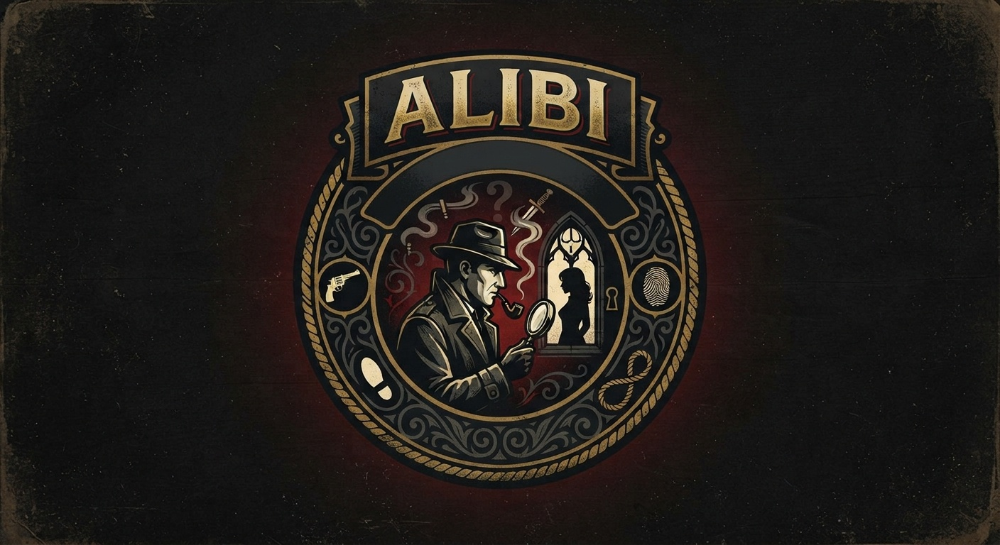
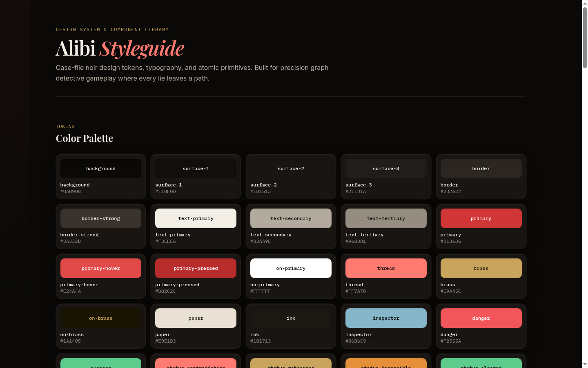
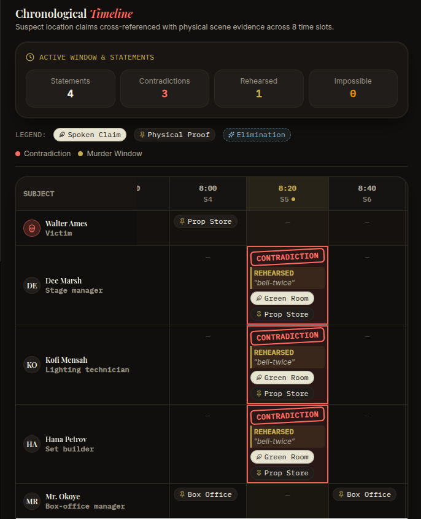
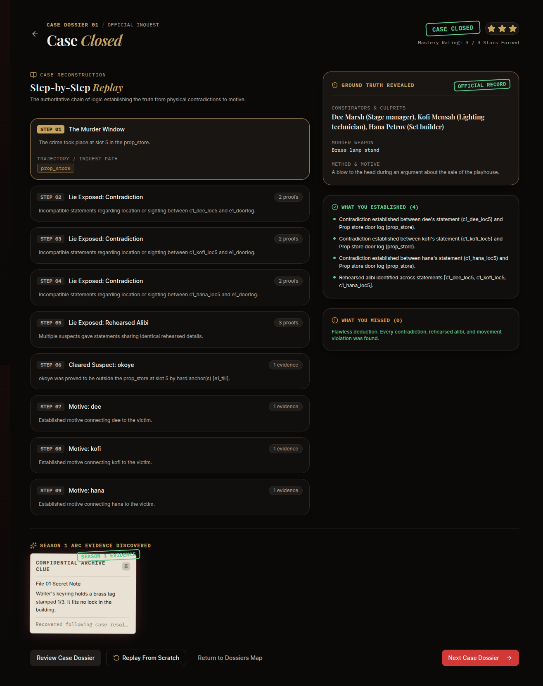
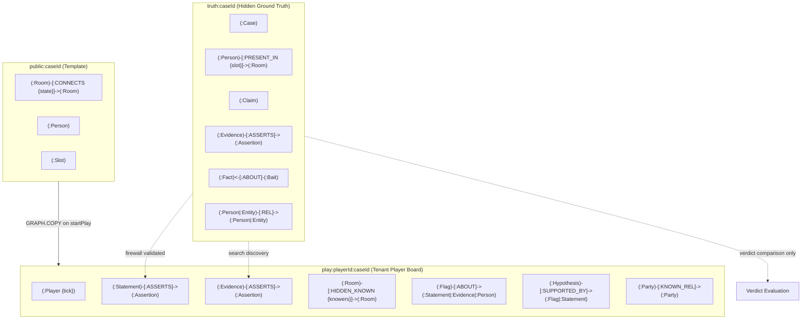
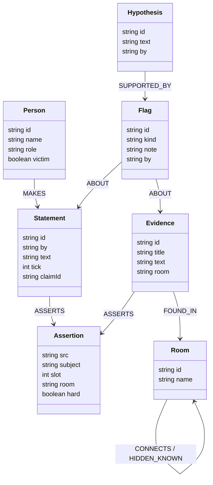

# Alibi — Every Lie Leaves a Path

<p align="center">
  
</p>

> **Track 01: Agents That Act on Connected Data**  
> *Graph Hacks 2026 (WeMakeDevs & FalkorDB)*  
> Built by **Ayo & Femi** · Team **Subaru Boys**

[](https://falkordb.com)
[](https://wemakedevs.org)
[](https://nextjs.org)
[](https://sdk.vercel.ai)
[](https://modelcontextprotocol.io)
[-success)](file:///tests)
[](#quickstart)

🎥 **Demo Video:** [Watch the Working Walkthrough](https://youtu.be/FuiIWO71Ogg)  
🌐 **Live Deployed App:** [https://alibi-game.vercel.app](https://alibi-game.vercel.app)  
📦 **Repository:** [https://github.com/Ayosensei/alibi](https://github.com/Ayosensei/alibi) (Public)


---

## 1. Pitch & Overview

In classic detective fiction, investigators pace a room cross-referencing floor plans, train timetables, and witness sightings connected by red thread on a corkboard. In software, reasoning over interdependent claims, physical room topologies, and contradictory alibis is not a vector search or prompt-engineering problem—**it is a graph problem**.

**Alibi** is an investigative detective game where every statement, every physical exhibit, and every alibi becomes nodes and edges in a **FalkorDB** graph. 

The player interrogates AI suspects, searches crime scenes for physical evidence, and watches their deduction board assemble in real time. But suspects lie. To crack each case, the player collaborates with an autonomous **AI Inspector** that reasons over the connected graph using graph queries and pathfinding algorithms. When an alibi collapses or a suspect makes an impossible journey across locked doors, the graph catches the lie—and the Inspector explains the exact path that proved it.

> 💡 **The Core Thesis (Track 01): The Graph is the Brain, the LLM is Just the Voice.**  
> - **FalkorDB executes all reasoning:** Every contradiction, shortest-path movement check, single-survivor candidate elimination, and multi-hop motive query runs as deterministic OpenCypher on FalkorDB.
> - **The LLM never writes Cypher and never receives Cypher:** It only roleplays suspect dialogue based on authored claims selected from FalkorDB, guarded by an automated graph firewall.
> - **Why SQL & Vector search fail:** Vector stores cannot enforce topological constraints (e.g., that a suspect cannot cross three locked rooms in one 20-minute window). Relational SQL requires costly recursive self-joins for multi-hop alibi trees and hidden motives. FalkorDB solves this natively in sub-millisecond graph traversals.

| Case Board & Conflict Threads | Timeline Grid & Rehearsed Story |
|:---:|:---:|
|  |  |
| *Graph board with contradiction threads* | *Timeline grid showing rehearsed alibi brackets* |

| Live Inspector Reasoning Stream | Verdict Replay & Ground Truth |
|:---:|:---:|
|  |  |
| *Autonomous AI Inspector running graph tools* | *Accusation score, replay path, and what was missed* |

---

## 2. Why This Needs a Graph: How and Why We Use FalkorDB

A relational database, vector store, or pure LLM cannot solve the deduction mechanics of Alibi. Every feature relies on connected graph topologies, traversal algorithms, and tenant graph isolation:

| Capability | FalkorDB (Alibi's Approach) | Relational SQL | Vector Search / RAG | Pure LLM |
|:---|:---|:---|:---|:---|
| **Contradiction Detection** | Instant dual-node pattern match on `(:Assertion)` | Slow self-join on wide assertion tables | Fails (semantic similarity misses discrete time/room clashes) | Prone to hallucinations & missed edge cases |
| **Physical Movement Feasibility** | `shortestPath()` graph traversal over door & keycard topologies | Complex recursive CTEs; brittle on cyclic graphs | Impossible (vectors cannot model room adjacency) | Hallucinates paths and ignores locked doors |
| **Single-Survivor Elimination** | Graph degree & path feasibility pruning down to 1 candidate | Painful multi-stage aggregation queries | Impossible | Cannot mathematically guarantee elimination |
| **Alibi-Support Chains** | Traverses witness dependency trees; cascades on conflict | Complex tree traversal tables | Impossible | Easily confused by circular claims |
| **Multi-Hop Motives** | Variable-length path traversal `[:KNOWN_REL*1..3]` | Costly recursive joins per hop | Fails to trace multi-hop entity relationships | Fabricates non-existent relationships |
| **Tenant Isolation** | Discrete graphs cloned via `GRAPH.COPY` in sub-ms | Risky row-level security (`WHERE tenant_id = ...`) | Leaky partitioned index namespaces | Prone to leaking ground truth in system prompt |

### The 6 Connected-Data Superpowers in Alibi:

1. **The Information Barrier (Graph-Level Multi-Tenancy)**  
   Ground truth (`truth:{caseId}`) is kept completely segregated from the player's deduction graph (`play:{playerId}:{caseId}`). Neither the player, the LLM, the AI Inspector, nor external MCP agents ever see the truth graph. When starting a case, `GRAPH.COPY` clones `public:{caseId}` into `play:{playerId}:{caseId}`. Tenants are discrete graphs, not leaky `WHERE` clauses.
2. **Contradictions as Graph Pattern Matching (`Q60_contradictions`)**  
   A lie is detected when two assertion nodes disagree on a suspect's location for the same time slot:
   ```cypher
   MATCH (a:Assertion), (b:Assertion)
   WHERE a.subject = b.subject AND a.slot = b.slot AND a.room <> b.room AND a.src < b.src
   RETURN a.src AS srcA, a.room AS roomA, b.src AS srcB, b.room AS roomB
   ```
3. **Feasibility via Shortest Path Traversal (`Q63_distance`)**  
   Moving between rooms takes 1 time slot per edge. Given hard anchors (camera stills, electronic keycard logs), can a suspect physically traverse the map between slot $i$ in room $A$ and slot $j$ in room $B$? FalkorDB calculates the shortest path over active edges:
   $$\text{feasible} \iff \text{shortestPath}(A, B) \le |j - i|$$
   If door locks or hidden passage access rules (`knowers`) block the path, the suspect is provably cleared or exposed.
4. **Single-Survivor Elimination Chains (`whoCouldHave`)**  
   Physical evidence records an act (e.g., circuit breaker tripped at slot 4). Graph feasibility eliminates impossible suspects one by one. When only a single candidate remains, an inferred anchor node `(:Assertion {hard: true, src: 'inferred:<id>'})` is written to the graph, immediately triggering downstream contradictions against their prior claims.
5. **Alibi-Support Dependency Trees (`Q71_alibi_support`)**  
   Witness sightings form a dependency tree: suspect $A$ claims to be in the lounge because witness $B$ claims to have seen them there. If graph contradictions place witness $B$ elsewhere, the supporting edge breaks and the entire alibi chain collapses.
6. **Multi-Hop Motive Traversals (`Q70_motive_paths`)**  
   Variable-length path queries `(p:Party)-[:KNOWN_REL*1..3]-(v:Person {victim: true})` uncover hidden corporate, familial, and financial ties to the victim across intermediate entities.

---

## 3. How the LLM is Used (and How the Graph Protects It)

In Alibi, Gemini Flash is used solely for **in-character dialogue voicing**, protected by a graph-enforced firewall:

```
[Player Question] 
       │
       ▼
[FalkorDB Cypher Q40_select_claims] ──► Retrieves only eligible authored claims for suspect
       │
       ▼
[Gemini Flash (via Vercel AI SDK)] ───► Synthesizes persona & voice into structured JSON:
       │                                 { reply: string, claimIds: string[] }
       ▼
[The Graph Firewall] ─────────────────► 1. Verifies claimIds match allowed graph claims
       │                                2. Screens for forbidden ground-truth leaks
       ▼
[Play Graph Update (Q43_add_statement)]► Statement node added to player's FalkorDB graph
```

- **Zero Cypher in Prompts:** The LLM never writes or executes Cypher. All 58 queries are parameterised constants in [`src/engine/queries/`](file:///home/saturnsurfer/Documents/PROJECTS/alibi/src/engine/queries/).
- **Zero Hallucination of Facts:** Suspects can only express claims selected from FalkorDB. If a model tries to invent details or leak truth, the firewall rejects the reply and falls back to authored claim text.
- **100% Offline Capable:** If no API key is provided (`ALIBI_LLM=off`), the game runs 100% deterministically using the pre-authored claim text templates. Judges need zero API keys to evaluate the project.

---

## 4. Quickstart

Get Alibi up and running locally in 5 commands:

```bash
# 1. Start FalkorDB and FalkorDB Browser
docker compose up -d falkordb

# 2. Install dependencies & configure git hooks
pnpm i

# 3. Validate case graphs and mathematical solvability
pnpm cases:validate

# 4. Run the full test suite (75 tests against live FalkorDB)
pnpm test

# 5. Start the web application on port 3001
pnpm dev
```

Open [http://localhost:3001](http://localhost:3001) in your browser.

- **FalkorDB Browser:** Available at [http://localhost:3000](http://localhost:3000) to inspect graph queries and node structures live.
- **Zero API Key Needed (`ALIBI_LLM=off`):** The game runs 100% deterministically offline without an API key by falling back to pre-authored claim texts. To enable live Gemini synthesis, set `GEMINI_API_KEY` in `.env`.
- **Reset Demo State:** Run `pnpm demo:reset` to clear all player demo graphs.
- **Model Context Protocol (MCP):** Run `pnpm mcp` to start the stdio MCP server for Claude or Cursor.

---

## 5. The Three Cases & Mechanics

Season 1 introduces three original, self-contained mystery cases designed to teach distinct graph reasoning capabilities:

| Level | Case | Premise | Graph Mechanics Taught |
|:---|:---|:---|:---|
| **Level 1** | *The Quiet Pact* | A theatre director is murdered in the prop store during rehearsal. Three actors tell identical stories. | Contradiction pattern matching, rehearsed alibi grouping, clearing an innocent suspect by impossibility. |
| **Level 2** | *The Stopped Watch* | An antiquarian is found dead next to a smashed pocket watch stopped at 9:40 PM. | Time-of-death window revision, impossible movement sequences, baiting a suspect into a knowledge slip. |
| **Level 3** | *The Blackout Dinner* | An estate patriarch is killed in a locked study during an 8-minute power cut. | Hidden passage discovery (`HIDDEN_KNOWN`), candidate elimination, alibi-support chain collapse, multi-hop motive paths. |

### Season 1 Arc: "The Auditor"
Every case solved unearths an archival dossier fragment pointing toward a shadow syndicate known as *The Auditor*. The clues combine on the player's dossier to reveal the overarching conspiracy.

---

## 6. Graph Data Model & Information Barrier

Alibi maintains three distinct graph scopes to preserve the **Information Barrier**:



### Graph Topologies
1. `truth:{caseId}`: Master ground truth created once during seeding. Contains true movements (`PRESENT_IN`), all claims with truth labels, crime scene parameters, and fact knowledge maps.
2. `public:{caseId}`: Clean case template with public rooms, standard doors, suspect biographies, and time slots.
3. `play:{playerId}:{caseId}`: The isolated tenant workspace. When a player begins a case, `GRAPH.COPY` clones `public:{caseId}` into `play:{playerId}:{caseId}`. As statements are taken and rooms are searched, nodes are added exclusively to this graph.
4. `player:{playerId}`: Anonymous persistence graph tracking case completions, brass stars, and accusation counts.

### Detailed Property Graph Schema Map (FalkorDB)

The player's deduction graph (`play:{playerId}:{caseId}`) maps real-time investigation evidence into connected graph primitives:



### Graph Node & Edge Dictionary

| Node Label | Key Properties | Purpose in Deduction |
| :--- | :--- | :--- |
| `(:Room)` | `id`, `name` | Vertices of the physical floor plan. Connected by directional `[:CONNECTS {state}]` or unlocked `[:HIDDEN_KNOWN {knowers}]`. |
| `(:Person)` | `id`, `name`, `role`, `victim` | Suspects and victims of the inquiry. Target for feasibility shortest-path pruning and motive paths. |
| `(:Statement)` | `id`, `by`, `text`, `tick`, `claimId` | Interrogation statements recorded from suspects during gameplay. |
| `(:Evidence)` | `id`, `title`, `text`, `room` | Physical exhibits discovered by searching rooms (keycard door logs, cash receipts, diaries, weapons). |
| `(:Assertion)` | `src`, `subject`, `slot`, `room`, `hard` | Atomic location or sighting facts. When two assertions clash on `(subject, slot, room)`, Cypher detects a contradiction (`Q60`). |
| `(:Flag)` | `id`, `kind`, `note`, `by` | Visual corkboard pins (`contradiction`, `rehearsed`, `impossible`) placed by the player or AI Inspector. |
| `(:Hypothesis)` | `id`, `text`, `by` | Synthesized deductions linking multiple flags into an evidentiary conclusion. |

### Concrete Subgraph: Catching the Murder Conspiracy in Level 1

```mermaid
graph LR
  subgraph RehearsedConspiracy ["Rehearsed Alibi Clustered via Q61_rehearsed"]
    D_Stmt["(:Statement {by: 'dee'})"] -->|ASSERTS| A_Green["(:Assertion {subject: 'dee', slot: 5, room: 'green_room'})"]
    K_Stmt["(:Statement {by: 'kofi'})"] -->|ASSERTS| K_Green["(:Assertion {subject: 'kofi', slot: 5, room: 'green_room'})"]
    H_Stmt["(:Statement {by: 'hana'})"] -->|ASSERTS| H_Green["(:Assertion {subject: 'hana', slot: 5, room: 'green_room'})"]
  end

  subgraph PhysicalEvidence ["Physical Crime Scene Discovery"]
    E_Log["(:Evidence {id: 'e1_doorlog'})<br/>Prop Store Keycard Log"] -->|ASSERTS| A_Prop["(:Assertion {subject: 'dee', slot: 5, room: 'prop_store', hard: true})"]
  end

  A_Green <== "CLASH (Q60_contradictions)<br/>slot 5: green_room vs prop_store" ==> A_Prop

  style A_Green fill:#2d1a10,stroke:#d4a359,stroke-width:2px
  style A_Prop fill:#3d1414,stroke:#e05252,stroke-width:2px
  style E_Log fill:#1e2430,stroke:#60a5fa,stroke-width:2px
```

The diagram below illustrates how FalkorDB evaluates the conspirators' lie in *The Quiet Pact*:



---

## 7. Cypher Queries and Reasoning Catalog

All Cypher queries are parameterised, named constants stored in [`src/engine/queries/`](file:///home/saturnsurfer/Documents/PROJECTS/alibi/src/engine/queries/) and mirrored in [`queries/`](file:///home/saturnsurfer/Documents/PROJECTS/alibi/queries/). The LLM **never** writes or executes arbitrary Cypher.

| Category | Query IDs | Target Graph | Primary Operations & Algorithms |
|:---|:---|:---|:---|
| **Lifecycle & Seeding** | `Q00-Q03`, `Q10-Q24` | System, Truth, Play | `GRAPH.COPY`, `GRAPH.DELETE`, idempotent batch node/relationship seeding, player tick counters. |
| **Dialogue & Interrogation** | `Q40-Q45` | Truth, Play | Knowledge firewall filtering, statement ingestion, assertion node generation. |
| **Physical Evidence & Scene** | `Q50-Q59` | Truth, Play | Room item retrieval, keycard door log parsing, revealed passage assertions, inferred anchor writes. |
| **Graph Pattern Matching** | `Q60-Q62` | Play | Contradiction pair detection (subject + slot collision), rehearsed alibi grouping across suspects. |
| **Topology & Shortest Path** | `Q63-Q68` | Play | `shortestPath` distance traversal, active map edge query, single-survivor candidate elimination (`whoCouldHave`). |
| **Relational Chains** | `Q70-Q72` | Play | Variable-length multi-hop motive traversals (`[:KNOWN_REL*1..3]`), alibi dependency trees, time-of-death window calculation. |
| **Notes & Verdict Inquest** | `Q80-Q99` | Play, Truth | Visual Flag/Hypothesis writes, knowledge-slip bait evaluation, final accusation grading against ground truth. |

---

## 8. Tool Catalogue & Model Context Protocol (MCP)

The reasoning engine exposes 8 read tools and 2 board write tools governed by strict [Zod schemas](file:///home/saturnsurfer/Documents/PROJECTS/alibi/src/engine/contract.ts):

| Tool | Type | Description |
|:---|:---|:---|
| `getBoard` | Read | Returns complete player graph: statements, evidence, flags, hypotheses, threads. |
| `findContradictions` | Read | Finds conflicting assertions for same person & slot across the play graph. |
| `findRehearsedAlibis` | Read | Identifies suspicious story duplication across 2 or more suspects. |
| `findImpossibleMoves` | Read | Identifies journeys that exceed reachable physical distance between slots. |
| `checkFeasibility` | Read | Determines if a person could have reached a room at a slot given hard anchors. |
| `whoCouldHave` | Read | Evaluates candidates for an act piece of evidence, returning survivors. |
| `motivePaths` | Read | Traverses multi-hop relationship chains between suspect and victim. |
| `alibiSupport` | Read | Evaluates whether a witness alibi is corroborated or collapsed. |
| `flag` | Write | Drops a visual Flag note onto specific board nodes with an explanation. |
| `hypothesize` | Write | Writes a deduction Hypothesis node connected to supporting flags. |

### Model Context Protocol (MCP) Integration
Any external MCP-compliant agent (Claude Desktop, Cursor, AGY) can connect directly to Alibi's reasoning engine via stdio:

```json
{
  "mcpServers": {
    "alibi": {
      "command": "pnpm",
      "args": ["mcp"],
      "cwd": "/path/to/alibi"
    }
  }
}
```

The MCP server exposes all 8 reasoning read tools, enabling external agents to analyze player boards and solve cases using graph reasoning.

---

## 9. Track 01 Rubric Alignment

| Track 01 Requirement | How Alibi Satisfies It |
|:---|:---|
| **Multi-hop reasoning** | 1-3 hop motive traversals (`Q70`), shortest path journey validation (`Q63`), multi-step candidate elimination chains, and alibi dependency trees (`Q71`). |
| **Graph queries as agent tools** | 10 formal tools backed by 58 named, parameterised Cypher queries executed via FalkorDB's official client. |
| **Tool selection through MCP** | Standalone stdio MCP server (`pnpm mcp`) exposing the full reasoning tool suite to outside agents. |
| **Actions based on graph output** | Autonomous AI Inspector writes `Flag` and `Hypothesis` nodes onto the user's board and renders dynamic conflict threads based on query results. |
| **Explainable results** | Every tool call returns a complete `TraceStep[]` (query ID, parameters, rows, latency ms) and step-by-step room traversal paths. |

---

## 10. Quality Verification & Mathematical Parity

To ensure fair mysteries without plot holes or mathematical ambiguity, Alibi implements dual verification:

1. **The Reference Engine (`scripts/reference-engine.mjs`):** A pure JavaScript oracle implementation of every reasoning tool. Vitest tests (`tests/engine/reasoning.test.ts`) assert exact 1:1 parity between Cypher execution in FalkorDB and the oracle across cold, partial, and completed boards.
2. **Case Solvability Validation (`scripts/validate-cases.mjs`):** Every case JSON file is validated mathematically before runtime:
   - Exactly the intended culprits are solvable.
   - Every false claim is detectable through contradictions, impossible moves, or inferred anchors.
   - Every innocent suspect is provably cleared.
   - Baits with 1 knower point only to guilty culprits.

---

## 11. AI Usage Disclosure

Per hackathon guidelines, AI coding assistance is fully disclosed:
- **Assistant:** Gemini 3.8 Flash via Google DeepMind Antigravity CLI.
- **Human Authors & Architects (Ayo & Femi · Team Subaru Boys):** Conceived the product architecture, designed the tripartite information barrier model, authored all three original mystery plots and clues, specified the design system (`DESIGN.md`), and authored the Cypher query catalog.
- **AI Coding Agent:** Assisted with implementing TypeScript schemas, unit tests, parity test suites against the oracle, React components, and styling token enforcement.
- **Commit History:** Every agent-assisted commit includes the mandatory `Assisted-by: Gemini` trailer.

---

## 12. Originality and Credits

Inspired by classic closed-circle detective fiction and consultant-detective television. All cases, characters, floor plans, and puzzles are original fictional works. No third-party scripts, plots, or intellectual property were used.

Released under the **MIT License**.
